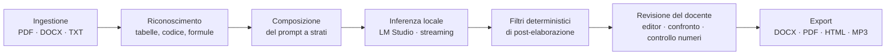

# Edu4All

**Adattamento di materiali didattici per studenti con DSA, ADHD o disabilità visiva, con un modello linguistico compatto eseguito in locale.**

Edu4All è un'applicazione web che prende una dispensa (PDF, Word o testo) e ne produce una versione accessibile per un profilo di bisogno specifico. Il testo adattato si può rivedere e correggere, poi scaricare in Word, PDF, HTML o MP3.
Il modello gira sul computer del docente: il testo e il profilo dello studente non vengono inviati a servizi esterni.

È il progetto della mia tesi di laurea magistrale in **Informatica Umanistica**, *Modelli linguistici compatti per la didattica inclusiva: progettazione e sviluppo dell'applicazione Edu4All* (a.a. 2025/2026).


<!-- Screenshot: salva le immagini in docs/screenshots/ e togli il commento


-->

---

## Il problema

La normativa riconosce agli studenti con bisogni educativi speciali il diritto a materiali adattati. Adattare però una singola unità didattica a più profili richiede di riscriverla, reimpaginarla e verificarla, e questo tempo il docente quasi mai lo ha. Così l'adattamento finisce per coprire solo le verifiche e lascia scoperto lo studio di tutti i giorni.

Edu4All non sostituisce il docente: gli prepara una **prima versione** da correggere, così il lavoro di adattamento diventa sostenibile.

## Come funziona

L'interfaccia guida l'utente in quattro fasi, sempre visibili come pannelli a scomparsa:

1. **Profilo**: si sceglie lo studente a cui è destinato il materiale (ADHD, DSA o non vedente).
2. **Testo e opzioni**: si carica un file o si incolla il testo. Si indicano livello scolastico e/o età, lingua del risultato (italiano o inglese) ed eventuali istruzioni libere. L'app riconosce da sola se il testo contiene **tabelle, codice o formule** e il docente può correggere la proposta.
3. **Revisione**: il testo generato si modifica in un editor visuale accessibile oppure in Markdown. C'è un confronto affiancato con l'originale e un **controllo automatico dei dati numerici**.
4. **Download**: si scarica il testo in Word, PDF o HTML, oppure come audio in due versioni, *lettura semplice* e *lettura con descrizione*.

### Cosa cambia per ogni profilo

| Profilo | Strategia di adattamento | Nel documento esportato |
|---|---|---|
| **DSA** | Frasi brevi, forma attiva, un'idea per paragrafo, termini tecnici mantenuti con una glossa tra parentesi | Verdana, corpo 14, interlinea 1.5 |
| **ADHD** | Blocchi brevi con titolo, elenchi, parole chiave in grassetto, un solo riepilogo finale che elenca gli argomenti senza anticipare le conclusioni | Struttura a blocchi |
| **Non vedente** | Gerarchia esplicita di titoli, ordine lineare, tabelle trasformate in frasi complete, simboli scritti per esteso | HTML e Word con marcatura semantica, audio descrittivo |

Il principio comune è che **si adatta la forma, non il contenuto**: nessun fatto, dato o passaggio logico dell'originale deve sparire.

### Contenuti che non si possono "semplificare"

Lo sviluppo ha fatto emergere una seconda variabile oltre al profilo, cioè il **tipo di contenuto**. Il profilo stabilisce *come* trasformare, il contenuto stabilisce *che cosa è lecito* trasformare.

- **Tabelle**: tutti i valori vanno conservati. Per DSA e ADHD la tabella resta tabella, con intestazioni più chiare. Per il profilo non vedente ogni riga diventa una frase che nomina tutte le colonne.
- **Codice**: va riprodotto identico, rientri compresi; si adatta solo la spiegazione intorno. Si può aggiungere un diagramma di flusso.
- **Formule**: pedici e coefficienti restano invariati, perché in chimica `2 H₂O` e `H₂O₂` sono sostanze diverse. Per il profilo non vedente ogni formula viene anche letta a parole.

## Architettura



La parte probabilistica (il modello) è confinata a **un solo stadio**. Tutto ciò che una regola può governare è fatto in codice deterministico:

- **Prompt a strati.** L'istruzione di sistema si compone da profilo, moduli di contenuto, livello scolastico, età, istruzioni del docente e lingua. Le combinazioni crescono in modo moltiplicativo, i testi da scrivere solo in modo additivo.
- **Reti di sicurezza.** Dei filtri deterministici rimuovono le frasi "di cornice" del modello ("Ecco il testo…"), correggono la marcatura, spostano il riepilogo ADHD in fondo e trasformano in elenchi le tabelle rimaste nel testo per il profilo non vedente.
- **Rappresentazione intermedia in Markdown.** L'inferenza avviene una sola volta e tutti i formati di uscita si generano da quel testo. Per aggiungere la traccia audio descrittiva è bastata una nuova funzione di conversione.
- **Diagramma di flusso** (`diagramma.py`). Il modello non genera un'immagine ma il *sorgente* Graphviz del diagramma, che viene ripulito e disegnato in modo deterministico. Lo stesso sorgente, riletto in forma discorsiva, diventa la descrizione accessibile del diagramma, scritta e parlata.
- **Audio descrittivo** (`audio_descrittivo.py`). È una conversione deterministica: annuncia la struttura delle tabelle e nomina le colonne a ogni riga, dichiara il livello di rientro di ogni riga di codice e legge i pedici delle formule.
- **Controllo dei dati numerici.** Estrae e normalizza i numeri dei due testi (1.000 = 1000, 6,0 = 6) e segnala quelli comparsi o scomparsi. Il sistema **segnala, non corregge**: a decidere quale valore è giusto è il docente.

### Scelte di progetto

- **Modello compatto in locale** (Llama 3 8B Instruct tramite LM Studio). Un materiale didattico associato al profilo di uno studente è un dato relativo alla salute (art. 9 GDPR). In locale il problema del trasferimento a terzi non si pone, e in più l'uso non ha costi a consumo e funziona senza connessione.
- **Nessun database.** Lo stato vive solo in `st.session_state` e i file si generano in memoria (`io.BytesIO`). Chiudendo la scheda del browser non resta traccia.
- **Human in the loop.** Il testo generato è sempre una proposta: l'utente scarica solo il testo rivisto nella Fase 3.
- **Parametri di inferenza.** Temperatura 0,3 per restare aderenti alla fonte; `max_tokens` 4096 per evitare tagli a metà; testo in ingresso limitato a 15.000 caratteri, con avviso esplicito invece di un troncamento silenzioso.

## Risultati della sperimentazione

Ho testato l'app su quattro documenti didattici scritti apposta (geografia, statistica, chimica, informatica), ciascuno adattato per i tre profili. Sui due documenti con le tabelle più complesse ho confrontato il modello locale con un modello di frontiera usato via API. I risultati principali:

- **L'infedeltà sui dati tabellari non dipende dalla dimensione del modello.** Il modello di frontiera ha commesso errori dello stesso tipo e, in un caso, identici a quelli del modello locale.
- **Gli errori numerici sono di due tipi.** Nella *sostituzione esterna* il modello mette al posto del dato della fonte un valore "che conosce". Nel *disallineamento interno* i valori sono giusti ma finiscono nella cella sbagliata, perché l'estrazione dal PDF appiattisce la tabella. Il controllo automatico intercetta solo il primo tipo.
- **Convertire in prosa preserva i dati meglio che ricostruire la griglia.** Il profilo non vedente, che richiede la trasformazione più radicale, ha dato gli esiti numericamente più fedeli. Su questo compito il modello locale ha fatto meglio di quello di frontiera, che in un caso ha eliminato la tabella senza convertirla.
- **Il codice è stato riprodotto identico in tutti gli esiti.** Il sistema è più affidabile proprio dove l'istruzione gli chiede di *astenersi* dal generare.
- **Le regole e le definizioni sono state eliminate in 9 esiti su 9**, nonostante il prompt lo vietasse esplicitamente. Un'istruzione può nominare una categoria, ma non garantisce che il modello riconosca quali frasi vi appartengono.

La conclusione è che l'esito grezzo **non è somministrabile così com'è**: la revisione del docente non è un'opzione ma una condizione d'uso. È per questo che l'architettura la mette al centro.

## Accessibilità dell'interfaccia

L'interfaccia è progettata secondo le **WCAG 2.1 livello AA** e nel codice ogni scelta è annotata con il criterio corrispondente: contrasti misurati per ogni colore, skip link, focus visibile, controlli alti almeno 44 px, rispetto di `prefers-reduced-motion`, lingua della pagina dichiarata e un editor con ruoli ARIA e scorciatoie da tastiera.

L'audit con Google Lighthouse ha dato **100/100**. La prova manuale da sola tastiera ha però trovato un problema: alcuni componenti generati da Streamlit non rispondono correttamente alla navigazione da tastiera. È un limite noto, documentato nella tesi.

## Tecnologie

| Ambito | Strumenti |
|---|---|
| Interfaccia e logica | Python, Streamlit, componente custom HTML/JavaScript per l'editor |
| Modello linguistico | Meta Llama 3 8B Instruct, LM Studio (API compatibile OpenAI, client `openai`) |
| Lettura dei documenti | PyMuPDF, python-docx |
| Generazione dei documenti | python-docx (con `w:tblHeader` per le tabelle), fpdf2 con font DejaVu Unicode, HTML5 semantico |
| Audio | gTTS |
| Diagrammi | Graphviz (sorgente DOT generato dal modello, disegno deterministico) |

## Struttura della repository

```
edu4all/
├── app.py                  # applicazione Streamlit (interfaccia, prompt, pipeline, export)
├── audio_descrittivo.py    # traccia audio descrittiva per tabelle, codice, formule, diagrammi
├── diagramma.py            # estrazione, disegno e descrizione del diagramma di flusso
├── requirements.txt
├── esempi/                 # i quattro documenti usati nella sperimentazione
├── docs/screenshots/
└── font/                   # (facoltativo) DejaVu Sans / Mono per il PDF Unicode
```

Al primo avvio l'app crea da sola la cartella `editor_component/`, che contiene l'editor della Fase 3.

## Installazione

**Requisiti:** Python 3, un computer con circa 16 GB di RAM, [LM Studio](https://lmstudio.ai/).

1. In LM Studio scarica il modello **Meta Llama 3 8B Instruct**, caricalo e avvia il server locale (porta `1234`).
2. Installa le dipendenze:
   ```bash
   pip install -r requirements.txt
   ```
3. Avvia l'app:
   ```bash
   python -m streamlit run app.py
   ```

Note:

- **Font per il PDF.** Senza i font DejaVu, i pedici e le frecce delle formule nel PDF diventano `H2O` e `->`. Su Linux di solito sono già installati; altrimenti copia `DejaVuSans.ttf`, `DejaVuSans-Bold.ttf`, `DejaVuSans-Oblique.ttf`, `DejaVuSans-BoldOblique.ttf` e `DejaVuSansMono.ttf` nella cartella `font/`.
- **Graphviz.** Serve solo per scaricare il diagramma come immagine. Oltre al pacchetto Python (già in `requirements.txt`), vanno installati i programmi Graphviz del sistema ([download](https://graphviz.org/download/); su macOS `brew install graphviz`, su Debian/Ubuntu `sudo apt install graphviz`). Senza Graphviz l'anteprima e le descrizioni scritta e parlata funzionano lo stesso.
- **Altro modello.** Per usare un modello diverso basta cambiare la costante `NOME_MODELLO` in `app.py`. I prompt però sono stati messi a punto su Llama 3 8B.

## Limiti noti

- **La sintesi vocale usa un servizio online (gTTS)**: è l'unico punto in cui il testo esce dal computer. Viene usata solo su richiesta e senza inviare il profilo dello studente.
- **Non c'è riconoscimento ottico (OCR)**: i PDF scansionati non sono supportati.
- **L'estrazione dal PDF perde la struttura** di titoli e tabelle, che il modello deve poi ricostruire.
- **Il PDF esportato non è marcato secondo PDF/UA**: per il profilo non vedente sono consigliati HTML, Word e audio.
- **I testi lunghi vengono troncati** a 15.000 caratteri (con avviso), non suddivisi in parti.
- **La traccia audio descrittiva e la descrizione del diagramma sono generate in italiano** anche quando il testo adattato è in inglese.

## Sviluppi futuri

- Un'estrazione delle tabelle che **conservi la struttura**, per eliminare alla radice il disallineamento interno.
- **OCR** per i materiali scansionati.
- Una **sintesi vocale locale**, per eliminare l'unica eccezione alla tutela dei dati.
- Un controllo numerico basato su **coppie etichetta-valore**, per intercettare anche i valori spostati di cella.
- **Validazione con docenti e studenti reali.**

## Crediti

- **Progettazione e sviluppo:** Diletta Lelli
- **Relatrice:** Prof.ssa Barbara Leporini
- **Correlatrici:** Prof.ssa Angelica Lo Duca, Prof.ssa Donatella Fantozzi

<!-- Aggiungi qui l'università e, se vuoi, il link alla tesi -->

## Licenza

<!-- Scegli una licenza (per esempio MIT) e aggiungi il file LICENSE -->
